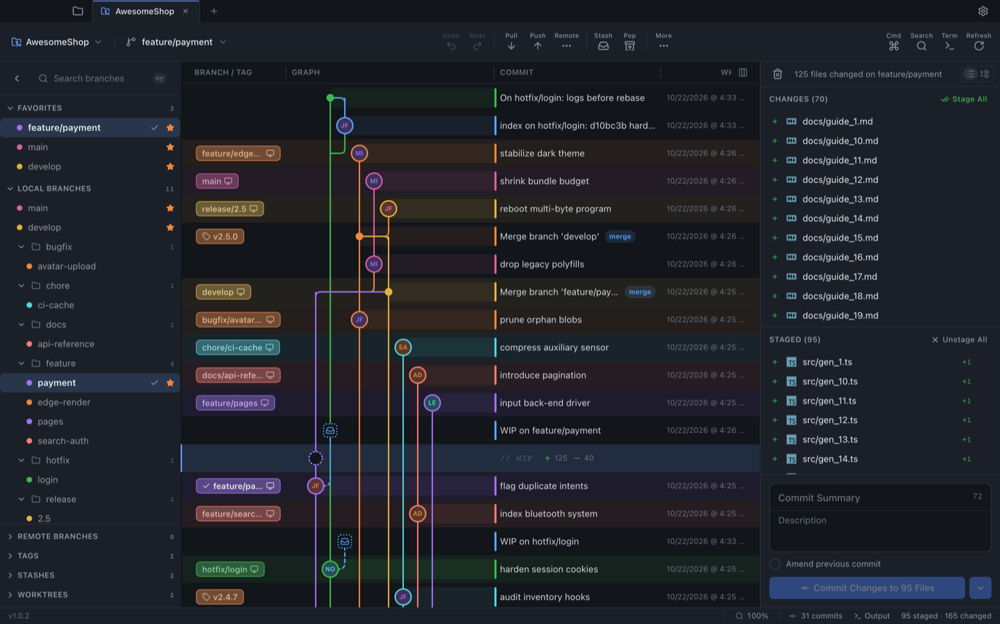

<p align="center">
  
</p>

# GitForge

> A free, open-source desktop Git client for macOS, built with Wails 3 (Go) and Vue 3 — commit graph, branch management, hunk staging, and real local Git operations. No account or subscription required.



GitForge is a graph-first Git client for browsing history, managing branches, staging changes, and running fetch/pull/push — executing real `git` commands against your local repositories through a Go backend. Open a folder, clone a URL, or init a new repo. Free under MIT.

## Features

- Commit graph with virtualized lanes, refs, search + keyboard navigation
- Branch sidebar: favorites, remotes, tags, stashes, worktrees; drag-and-drop merge/rebase
- Working tree with hunk staging, merge conflict editor, sign-off/GPG commits
- Diff viewer: unified/split, syntax highlighting, blame + file history, image diffs
- Merge / rebase / interactive rebase (reorder, squash, fixup) / cherry-pick / bisect
- Undo / redo, stash, force-push with lease (`--force-with-lease`)
- Fetch / pull / push with ahead/behind counts, remote maintenance, auto-fetch
- Multi-repo tabs, command palette (⌘K), custom/remappable shortcuts
- Git LFS tracking, Git output log for every command
- Themes, Basic/Advanced UI mode, resizable three-pane layout
- File watching auto-refresh, auto-update checks against GitHub Releases
- Native macOS menu bar, dialogs, and window background

## Requirements

- macOS 11+
- Node.js 20+
- Go 1.26+ (cgo enabled — the default)
- Git on your `PATH`

## Build & run

```bash
git clone https://github.com/JH12Ops/GitForge.git
cd gitforge
npm install

# Full desktop app: builds the renderer + Go backend, then launches GitForge.app
npm run dev:go

# Production build
npm run build && npm run go:build
open go-backend/GitForge.app
```

### Development modes

- `npm run dev` — browser dev on `:1420`: vite + a live headless Go dev gateway with **real git data** (rebuilds and restarts the gateway on `go-backend/**/*.go` changes, vite HMR for frontend edits)
- `npm run dev:mock` — vite-only browser dev with in-memory mock data (`VITE_USE_MOCK=true`)
- `npm run dev:go` — the real deal: builds the renderer, compiles the Go backend, and launches `GitForge.app`
- Serve the built renderer directly from the Go gateway without a desktop window:

  ```bash
  cd go-backend
  GITFORGE_LOCAL_TEST_ADDR=127.0.0.1:18333 go run .
  ```

## Checks

```bash
npm run check    # typecheck + vitest + version sync check + Go tests
```

Individually: `npm run typecheck`, `npm run test`, `npm run go:test`, `npm run go:vet`, `npm run sync-version -- --check`.

## Project layout

- `src/` — UI (Vue 3, Pinia, Tailwind v4). Never calls Git directly.
- `shared/git/` — contracts shared between renderer and backend (`models.ts` mirrors Go structs 1:1)
- `go-backend/` — Wails app and HTTP JSON gateway (`/gitforge/api/<command>` + SSE `/gitforge/events`); all `git` argv assembled in Go
- `docs/` — landing page assets and AI docs index (`llms.txt`)

More detail: developer guide in **[DEVELOPER.md](DEVELOPER.md)** · architecture in **[ARCHITECTURE.md](ARCHITECTURE.md)**.

## License

[MIT](LICENSE)
